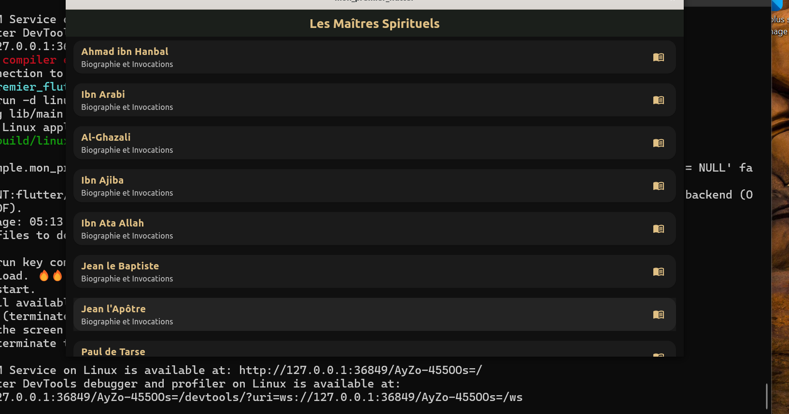
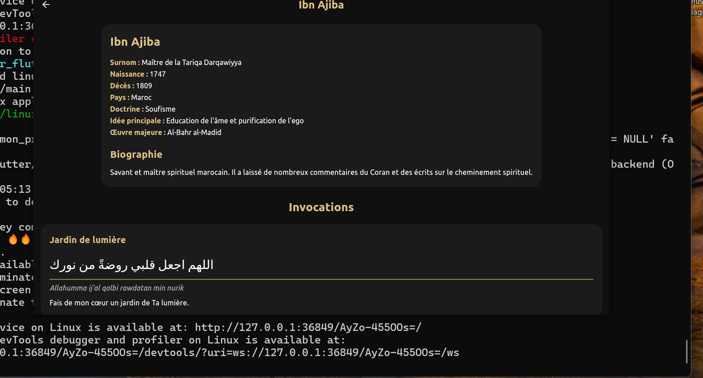
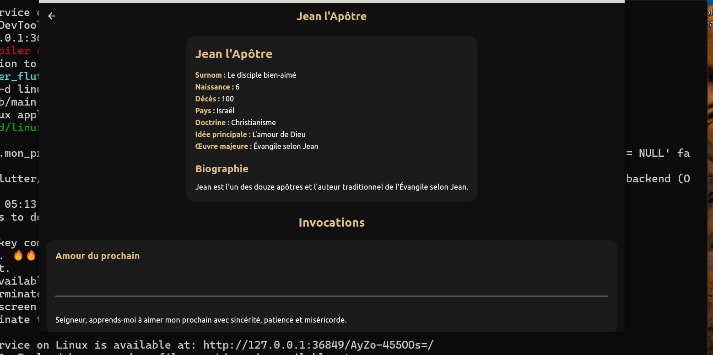

🌿 Chemins Spirituels
Chemins Spirituels est une application Flutter permettant de découvrir des maîtres spirituels, leurs enseignements, leurs biographies et des invocations issues de différentes traditions.

L'objectif du projet est de favoriser la découverte, la réflexion et la compréhension entre différentes sensibilités spirituelles à travers des figures historiques marquantes.

✨ Fonctionnalités
✅ Consultation de biographies de maîtres spirituels

✅ Invocations associées à chaque personnage

✅ Tradition islamique

✅ Tradition chrétienne

✅ Interface Flutter moderne

✅ Backend Node.js / Express

✅ Base de données MongoDB

✅ Navigation simple et intuitive

🌍 Vision du projet
Chemins Spirituels n'a pas pour objectif de comparer ou d'opposer les traditions.

L'application cherche au contraire à mettre en lumière les enseignements, les aspirations spirituelles et les valeurs de figures reconnues de différentes traditions afin de favoriser la connaissance mutuelle et le dialogue.

📚 Personnages présents

Tradition islamique

Abou Hanifa
Malik ibn Anas
Al-Shafi'i
Ahmad ibn Hanbal
Al-Ghazali
Ibn Arabi
Ibn Ata Allah
Ibn Ajiba
Sahl ibn Abd Allah at-Tustari
Abu Talib al-Makki
Abu al-Qasim al-Junayd
Abu Uthman Sa'id al-Hiri

Tradition chrétienne

Jean le Baptiste
Jean l'Apôtre
Paul de Tarse
Pierre
Augustin d'Hippone
François d'Assise

🛠 Technologies utilisées

Frontend
Flutter
Dart
Material Design

Backend

Node.js
Express.js

Base de données
MongoDB

🔄 Architecture
Flutter
   │
   ▼
Node.js / Express
   │
   ▼
MongoDB
Flutter affiche les données
Express fournit l'API REST
MongoDB stocke les biographies et les invocations

📸 Captures d'écran
## 📸 Captures d'écran

### Accueil

---

### Ibn Ajiba

---

### Jean l'Apôtre

🚀 Installation

Frontend Flutter
flutter pub get
flutter run

Backend Node.js
cd backend-nodejs
npm install
node server.js

🎯 Objectifs pédagogiques
Ce projet m'a permis de pratiquer :

Flutter
Dart
MongoDB
Node.js
Express
Git et GitHub
API REST
Développement mobile multiplateforme
👨‍💻 Auteur
Daoud Doghmane

Projet personnel réalisé dans le cadre de l'apprentissage du développement full-stack et du développement mobile.

GitHub : https://github.com/ddoghmane

📜 Licence
Projet éducatif et personnel.
